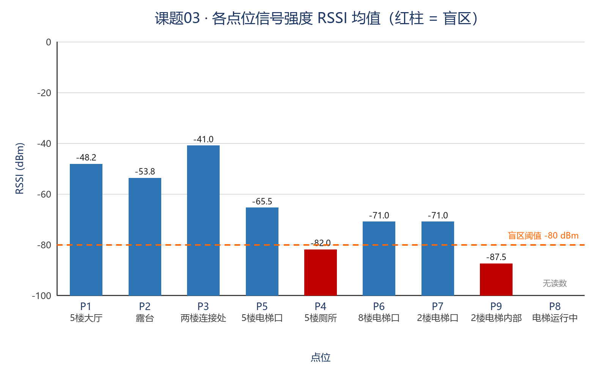
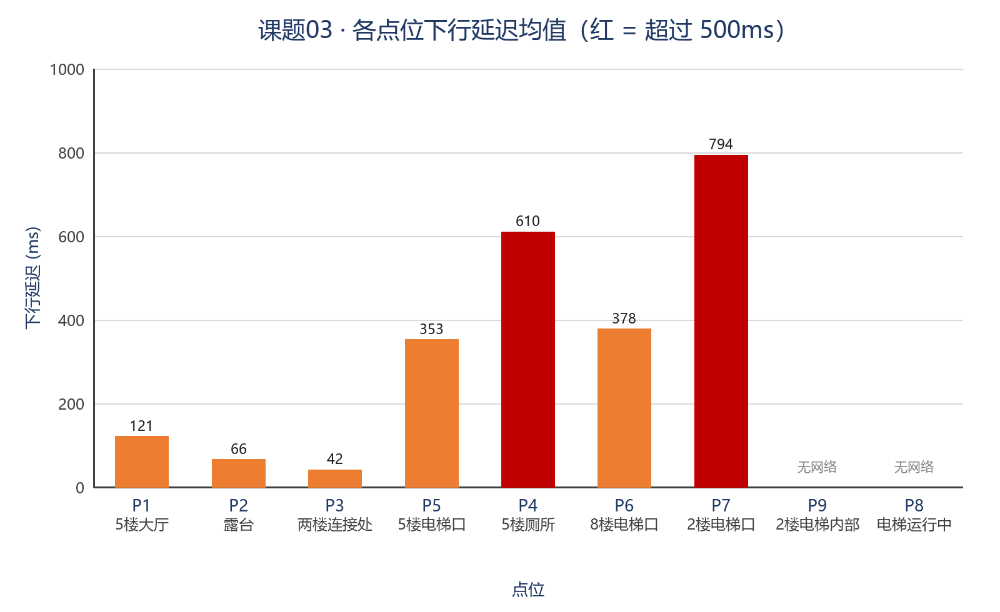
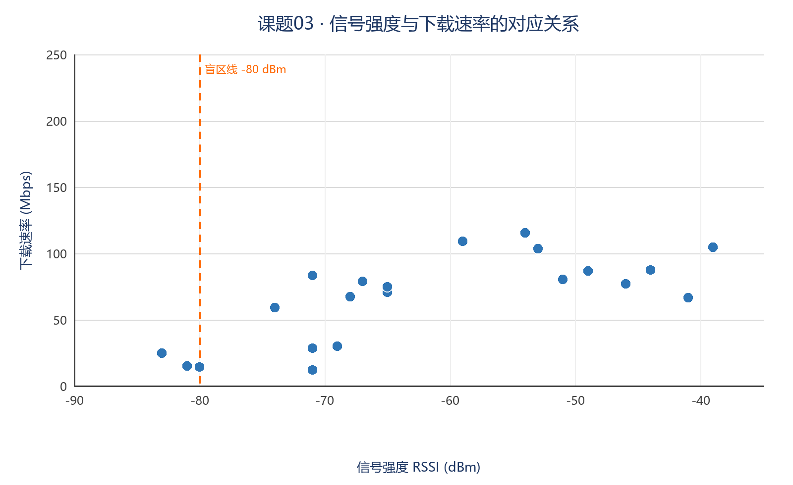
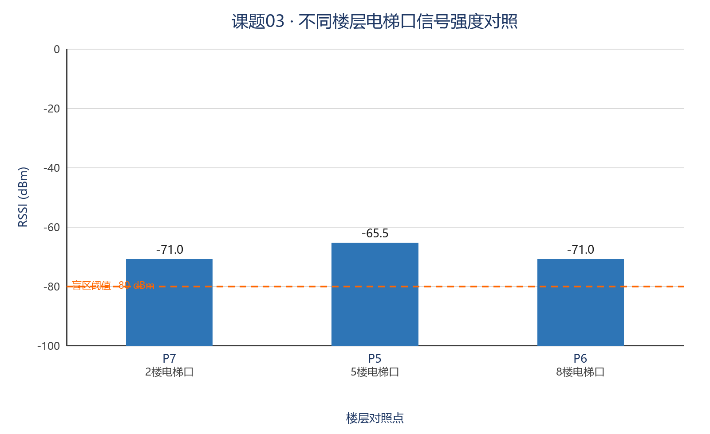

# 课题 03 · 教学楼无线信号盲区测绘 —— 分析报告

**报告人：** 黄心瑜
**班级：** 人工智能技术应用 C3 班
**学号：** 20261040153
**日期：** 2026-10-31

| 项目 | 内容 |
|---|---|
| 实验地点 | ICEC 校区 1 号楼（商贸学院） |
| 实验时间 | 2026-10-30 16:39–17:49（**第二轮**） |
| 测量设备 | 手机（荣耀 V30 Pro）；Wi-Fi 分析 App（读 RSSI）+ 测速网 App（测速率/延迟） |
| 网络环境 | SSID `SZIT-WLAN`，Wi-Fi 5（802.11ac） |
| 采样点位 | **9 个**（含 2 个电梯封闭点位，超出课题要求的 8 个） |
| 采样组数 | **36 条记录**：每个点位 RSSI 读 4 次、其中 3 次同步测速 |
| 主指标 | **信号强度 RSSI（dBm）** |
| 辅指标 | 下载/上传速率、下行/上行延迟、抖动、丢包率 |
| 盲区判定 | **RSSI 均值 < −80 dBm**（课题统一口径） |

> **一句话结论**：本楼的**厕所（−82.0 dBm）、2 楼电梯内部（−87.5 dBm）与两台电梯轿厢（完全无网络）是真实盲区**；
> 而 8 楼、2 楼电梯口虽然信号只有 −71 dBm、并未跌破盲区线，**延迟却高达 378 / 794 ms**——
> 说明「信号强度合格」不等于「上网体验合格」，**延迟是比 RSSI 更敏感的体验指标**。

---

## 一、两轮实验说明（为什么用第二轮数据）

本课题共做了两轮实地采样：

| | 第一轮 2026-10-28 | **第二轮 2026-10-30** |
|---|---|---|
| 点位 | 8 个 | 9 个 |
| 主指标 | ~~下载速率 MB/s~~ | **RSSI（dBm）** |
| 延迟 | ✗ 未采集 | ✓ 下行/上行延迟 |
| 抖动、丢包 | ✗ | ✓ |
| 判定口径 | 间接（< 1 MB/s） | **直接（< −80 dBm）** |

**第一轮的问题**：所用测速 App 只输出平均速率，**读不到 RSSI，也读不到延迟**，只能用下载速率间接推断盲区，与课题要求的「信号强度与延迟」不对齐。

**第二轮的改进**：改用 `Wi-Fi 分析` App 直接读取 dBm，并用 `测速网` 取得延迟、抖动与丢包，判定口径**回到课题原文的 −80 dBm**。

**因此本报告全部采用第二轮数据**，第一轮数据完整归档于 `../raw_data/03-wireless-signal-v1-20261028/` 与 `../photos/03-wireless-signal-v1-20261028/`，作为过程留痕（体现「发现问题 → 改进方法 → 重测」的完整闭环）。

---

## 二、点位设计（按遮挡机理分层）

| 编号 | 点位 | 楼层 | 遮挡特征 | 主要结构 / 材质 |
|---|---|---|---|---|
| P1 | 5 楼大厅 | 5F | 开阔无遮挡（**基准点**） | 玻璃幕墙 + 混凝土柱 + 吸音吊顶 |
| P2 | 露台 | 5F | 半开放，一侧临空 | 混凝土护栏 + 玻璃门 |
| P3 | 两楼连接处 | 5F | 半开放连廊 | 钢结构连廊 + 两侧混凝土墙 |
| P4 | 5 楼厕所 | 5F | **多重阻挡 + 金属隔断** | 隔断板材 + 瓷砖 + 上下水管道 |
| P5 | 5 楼电梯口 | 5F | 走廊尽头转角 | 钢筋混凝土核心筒 + 钢板电梯门 |
| P6 | 8 楼电梯口 | 8F | 走廊尽头转角（**楼层对照**） | 核心筒 + 钢板电梯门 |
| P7 | 2 楼电梯口 | 2F | 走廊尽头转角（**楼层对照**） | 核心筒 + 钢板电梯门 |
| P8 | 电梯运行中 | 5F→1F | **全金属封闭 + 运动** | 钢板轿厢 + 对重导轨 |
| P9 | 2 楼电梯内部 | 2F | **全金属封闭 + 阻燃胶合板内衬** | 钢板轿厢 + 阻燃胶合板内壁（**楼层对照点**） |

**设计要点**：
1. P1 为基准，其余点位与它相减得到**净衰减**；
2. P3、P2（半开放）与 P4（深埋核心筒）形成「同一楼层、不同封闭度」的对照；
3. **P5 / P6 / P7 是同一类点位、三个楼层**，构成垂直对照，单独考察「楼层」这一个变量；
4. P8 与 P9 是同一轿厢的「动」与「静」，用于隔离出运动这一个变量。

**采样方法**：每点位原地站立不动，RSSI 读取 4 次；其中 3 次同步跑完整测速（记录下载/上传/延迟/抖动/丢包）。全部 28 张 dBm 截图与 21 张测速截图存于 `../raw_data/03-wireless-signal/截图_dbm/`、`截图_测速/`，逐条可溯源。

---

## 三、数据总览

| 点位 | RSSI (dBm) | 下载 (Mbps) | 下行延迟 (ms) | 丢包 (%) | 判定 |
|---|---|---|---|---|---|
| P3 两楼连接处 | **−41.0** | 86.2 | **42** | 5.1 | ✅ 正常（最强） |
| P1 5 楼大厅 | **−48.2** | 81.5 | 121 | 2.6 | ✅ 正常（基准） |
| P2 露台 | **−53.8** | 109.4 | 66 | 12.4 | ✅ 正常 |
| P5 5 楼电梯口 | **−65.5** | 74.8 | 353 | 1.3 | ✅ 正常 |
| P6 8 楼电梯口 | **−71.0** | 70.0 | 378 | 1.6 | ⚠️ 临界 |
| P7 2 楼电梯口 | **−71.0** | 23.6 | **794** | 1.8 | ⚠️ 临界（延迟最差） |
| **P4 5 楼厕所** | **−82.0** | **18.2** | 610 | 1.2 | ❌ **盲区** |
| **P9 2 楼电梯内部** | **−87.5** | **未连接** | **未连接** | — | ❌ **盲区**（信号最低，测速失败） |
| **P8 电梯运行中** | **无读数** | **无网络** | **无网络** | — | ❌ **重度盲区** |



> 图 1：9 个点位的 RSSI 均值。橙色虚线为 −80 dBm 盲区线，**只有 P4 厕所的红色柱子跌破了它**；P8/P9 两台电梯因读不到 RSSI，柱子为空。



> 图 2：下行延迟均值。这张图比 RSSI 图更「刺眼」——**RSSI 排第二好的大厅，延迟 121 ms 却也不低；2 楼电梯口延迟 794 ms，是连接处（42 ms）的 19 倍**。



> 图 3：RSSI 与下载速率的散点。**盲区线左侧的 4 个点，下载全部低于 30 Mbps**；右侧则普遍在 60–115 Mbps。信号与吞吐的正相关清晰可见，但离群点（如 2 楼的 12 Mbps）说明还有别的因素在起作用。

---

## 四、多径衰减与墙体材质规律分析（核心）

### 4.1 先理解 dBm：为什么差 40 dB 就是天壤之别

RSSI 是对数单位：**每下降 3 dB，功率减半；每下降 10 dB，功率只剩 1/10**。

- 连接处 −41 dBm vs 厕所 −82 dBm，相差 **41 dB** → 功率相差约 **12500 倍**；
- 这解释了为什么厕所里连测速 App 都会弹「Wi-Fi 信号强度较弱，建议使用信号探测仪寻找最佳信号点」——它已经跌到链路余量不足的区间。

### 4.2 规律一：法拉第笼效应 —— 电梯是最彻底的屏蔽体

**现象**：P8（5 楼电梯运行中）与 P9（2 楼电梯内部，其中一次）**出现完全读不到 RSSI 的情况**，测速 App 直接报「**未检测到网络连接**」/「节点连接失败」。

**关键细节（本次最硬的证据）**：
手机状态栏的 **Wi-Fi 图标始终是亮的**（甚至显示满格），但 App 既读不出 Signal，也连不上服务器。这就是典型的**伪连接 / 假在线**——终端认为自己「关联着 AP」，但**实际链路容量已接近于零**。

**P9 提供了一条更细的中间态（重要）**：
2 楼电梯内部的 RSSI 是 **−87.5 dBm——能读出信号，但测速三次全部失败**：两次停在「正在连接」不动，一次直接弹「**节点连接失败 / 更换测速节点后重试**」。

这说明 P9 的屏蔽**不是彻底的**：信号还能漏进来（−87.5 dBm 刚好跌破盲区线），但链路余量已经不足以完成 TCP 握手与测速服务器建连。**这是「有信号、无连接」的教科书级样本**——比 P8 那种「完全无读数」更能说明信号强度存在一个**可用性阈值**：跌破 −80 dBm 后，即便 UI 上还显示 Wi-Fi，实际业务已经完全跑不通。

**P9 还记录到一次「完全无读数」**（同一轿厢、同一测点，App 连 Signal 都读不出）——这说明即使在 −87.5 dBm 这个「勉强能读」的平台附近，**信号也会在 ±几 dB 内摆到读不出来**，进一步佐证该点位处于链路存亡的临界带。

**机理**：
1. 轿厢六面钢板封闭，导电壳体对射频形成**静电屏蔽**，对 2.4/5 GHz 的屏蔽效能可达数十 dB，足以把信号压到噪声底；
2. 唯一漏口是门缝与按键线缆孔，孔径远小于波长（5 GHz 波长仅 6 cm），能量无法有效泄漏；
3. 运行中叠加**时变多径**：轿厢相对走廊 AP 持续移动，多径相位不断变化，TCP 重传被反复触发，最终表现为连接超时。

**与 P5 的对照**：同为 5 楼、同为电梯核心筒位置，**门外 P5 有 −65.5 dBm / 74.8 Mbps，门内电梯运行中（P8）连 RSSI 都读不到**。二者的唯一变量就是那道钢板门——这是排除楼层、距离、AP 容量后最干净的隔离验证。

**2 楼还提供了第二组更精细的对照**：门外 P7 为 −71.0 dBm，门内 P9 降到 **−87.5 dBm**——**同一层、隔一道门，掉 16.5 dB**（详见 4.6）。这组对照之所以更精细，是因为 P9 **能读出一个具体数值**（而不是像 P8 那样直接无读数），从而能算出确切的衰减量。

### 4.3 规律二：多重阻挡 —— 厕所是「墙体类」盲区

**现象**：P4 厕所 RSSI 四次为 **−81 / −83 / −80 / −84 dBm**，均值 **−82.0**，**跌破 −80 盲区线**；下载仅 18.2 Mbps（大厅的 22%），下行延迟 610 ms（大厅的 5 倍）。

> 注：P4 是**「墙体类」盲区**的代表（靠穿墙数累积衰减），与 P9「**屏蔽类**盲区」（靠金属壳体一次到位）机理不同，两者恰好构成对照——见 4.6。

**机理**：
1. **墙体与隔断串联**：厕所位于核心筒深处，从走廊 AP 到厕所需穿过走廊墙体 + 厕所外墙 + 隔间板材，属**多重串联损耗**；
2. **金属管道栅栏**：上下水立管（金属材质）在竖直方向构成周期性金属散射体，对电磁波相当于一道道栅栏，能量被反复吸收与漫反射摊薄；
3. **四个读数标准差仅 1.83 dB**——离散度很小，说明**这不是偶发抖动，而是稳定地处在一个低电平平台**。这比「忽高忽低」更能说明该位置存在结构性衰减。

### 4.4 规律三：多径反射的「反直觉」—— 连接处比大厅信号还强

| 点位 | 环境描述 | RSSI | 延迟 |
|---|---|---|---|
| P3 两楼连接处 | 半开放连廊，**两侧混凝土墙形成反射面** | **−41.0** | **42 ms** |
| P1 大厅 | 开阔大厅，玻璃幕墙 + 吸音吊顶 | −48.2 | 121 ms |
| P2 露台 | 半开放，**一侧完全临空无反射面** | −53.8 | 66 ms |

**结论一（关键）**：**连接处是全楼信号最强的点位，比「开阔」的大厅还好 7 dB。**
原因在于**多径增益**：连廊两侧的混凝土墙形成「**波导效应**」，把沿廊道传播的能量约束在一条通道内，反而减少了向四面八方散失的自由空间损耗。

**结论二**：**露台反而比大厅弱 5.6 dB**，因为一侧完全临空，没有任何反射面把能量「兜」回来——说明**「开阔」不等于「信号好」，反射体的分布才是决定因素**。

**结论三（对建议的直接影响）**：既然连廊的高速率依赖墙体反射，那么**任何在连廊里加装大面积金属隔断或金属展架的做法都会破坏这条「波导」**——这是本报告改进建议的重要依据。

### 4.5 规律四：信号达标 ≠ 体验达标 —— 延迟是更敏感的指标

**这是本次实验最有价值的发现。**

| 点位 | RSSI | 按 RSSI 判定 | 下行延迟 | 实际体验 |
|---|---|---|---|---|
| P1 大厅 | −48.2 | 正常 | **121 ms** | 好 |
| P5 5 楼电梯口 | −65.5 | 正常 | **353 ms** | 一般 |
| P6 8 楼电梯口 | −71.0 | 正常 | **378 ms** | 一般 |
| P7 2 楼电梯口 | −71.0 | 正常 | **794 ms** | **明显卡顿** |
| P9 2 楼电梯内部 | −87.5 | **盲区** | **未连接** | **完全不可用** |

2 楼电梯口的 RSSI 是 −71 dBm，**按教材口径「不算盲区」**，但**下行延迟 794 ms、一次测速下载只有 11.98 Mbps**。如果只用 RSSI 判定，就会漏掉这个「能连上但基本没法用」的位置。

**机理**：
- 信号弱到一定阈值后，Wi-Fi 会自动**降低调制编码等级（MCS）**并把帧切碎、增加重传，**吞吐下降的幅度远大于 RSSI 下降的幅度**；
- 同一位置还有多个终端争抢同一 AP，**排队时延**被放大；
- 所以：**RSSI 是「覆盖」指标，延迟是「体验」指标，两者必须一起看**。建议把「下行延迟 > 200 ms」作为本楼的**第二类盲区判据（体验盲区）**。

### 4.6 规律五：楼层内部的纵深衰减 —— 同一层，隔一道门掉 16.5 dB

**这是补测后新增、也是全表最有说服力的一条对照。**

| 位置 | 与 AP 的关系 | RSSI | 说明 |
|---|---|---|---|
| P7 2 楼电梯口 | 走廊内，**电梯门外** | **−71.0 dBm** | 尚可 |
| P9 2 楼电梯内部 | **仅隔一道电梯门** | **−87.5 dBm** | **跌破盲区线** |
| P8 5 楼电梯运行中 | 轿厢内 | 无读数 | 完全不可用 |

**关键数字**：
- 两点**同一楼层、相距不足 3 米**，只隔一道电梯门，**RSSI 相差 16.5 dB** → 功率相差约 **45 倍**；
- P9 的四次读数为 **−86 / −86 / −87 / −91**，**四次全部低于 −80**，标准差仅 2.38 dB —— 不是偶发抖动，而是**稳定的深度衰减**；
- 这一点**推翻了"电梯口和电梯内差不多"的直觉**：门内门外是两种完全不同的信道环境。

**机理（结合现场照片）**：
1. 现场照片 `P9_2楼电梯内部_轿厢内壁.jpg` 显示，轿厢内壁贴的是**「阻燃胶合板」（B1 级难燃材料）**——即**木质饰面板 + 背衬钢板**的复合结构；
2. 木材本身对 5 GHz 的损耗远小于金属，但**胶合板背后的钢板层才是真正的屏蔽体**；
3. 更关键的是**开门方向**：轿厢只有门缝一个开口，而这个开口**正对着门框与走廊侧墙**，形成多次反射的吸收腔；
4. 因此即使门开着，舱内也多处于**深衰落**状态——这也是 P9 依然读不到测速数据的原因。

**工程含义**：如果只测"电梯口"，会**严重低估电梯问题**。这也解释了为什么用户在电梯里常遇到"Wi-Fi 图标满格却打不开网页"。

---

### 4.7 规律六：楼层垂直衰减 —— 2 楼最差

用 **P7（2F）/ P5（5F）/ P6（8F）** 三个**电梯口**点位做垂直对照（电梯内部的纵深衰减见上一节）：

| 楼层 | 点位 | RSSI | 下载 (Mbps) | 延迟 (ms) |
|---|---|---|---|---|
| 2F | P7 | −71.0 | **23.6** | **794** |
| 5F | P5 | −65.5 | 74.8 | 353 |
| 8F | P6 | −71.0 | 70.0 | 378 |



> 图 4：不同楼层电梯口的 RSSI 对照。2F 与 8F 的 RSSI 数值相同（都是 −71），但 **2F 的下载与延迟都明显更差**。

**这条很关键**：**RSSI 相同的情况下，2 楼的下载速率只有 8 楼的约 1/3。**

既然信号强度一样，差异就只能来自 **AP 侧的拥塞**：2 楼是人员流动最密集的楼层（电梯厅、大厅、公告栏），**接入终端最多，共享同一 AP 的带宽被摊薄，排队时延被放大**。

→ 这属于 **「容量盲区」**，与「覆盖盲区」是两种完全不同的故障，**解决手段也完全不同**（前者靠负载均衡与分流，后者靠补点）。

---

## 五、低成本改进建议

原则：**不动主干、不重新布线、预算控制在数百元内**，按投入产出比排序。

### 方案 A：电梯盲区 —— 轿厢顶吸顶天线（约 100–200 元）

- 在**轿厢顶部**贴一颗小型全向天线，用 5 m 软馈线随轿厢线缆升至**层门上方检修口**，接入走廊主 AP；
- **关键细节**：天线要**偏向门缝一侧**安装，避开钢板正中心；
- 退路：在电梯门外走廊顶部加装吸顶 AP——但必须如实说明：**它改善的是等梯体感，对轿厢内部几乎无效，因为钢板还在那儿**。

### 方案 B：厕所盲区 —— 走廊侧壁中继（约 60–150 元/台）

- 在**厕所门外走廊**高处（2.2–2.5 m）装 Wi-Fi 中继器，与主 AP 无线回程；
- **部署铁律**：中继器必须放在**信号还好的那一侧**（走廊），绝不能装进厕所——否则转发的是已经烂掉的信号，只是把盲区复制了一遍。

### 方案 C：2 楼「容量盲区」—— 零硬件成本

P7 的瓶颈是拥塞而非覆盖，对应措施应落在**管理层面**：

1. **频段引导**：2F 电梯厅强制优先 5 GHz（信道多、干扰小）；
2. **AP 负载均衡**：把 2F 电梯厅的终端向相邻两个 AP 分流；
3. **QoS 限速**：对 2F 公共区域的大流量下载限速，保障交互类应用。

### 方案 D：保护连廊波导效应（零成本，但容易被忽略）

第 4.4 节证明连廊的高速率**依赖两侧墙体的多径反射**：

- 建议**避免在连廊两侧密集加装金属隔断、铁皮展架或大面积金属广告牌**；
- 如必须布展，优先使用布面 X 展架，避免金属材质破坏波导结构。

### 方案 E：零成本运维项

1. **信道规划**：2.4 GHz 只用 1/6/11 三个非重叠信道；
2. **排查 AP 位置**：确认 AP 未被装进管道井或吊顶深处（「挪一米」能救一片）；
3. **门口公示**：在电梯口、厕所门口贴「本区域信号弱，建议切 2.4 GHz」提示，成本≈0。

### 优先级排序

| 优先级 | 措施 | 预算 | 受益点位 | 预期效果 |
|---|---|---|---|---|
| **P0** | 方案 E（信道 + 公示） | 0 元 | 全楼 | 立竿见影 |
| **P1** | 方案 C（2F 负载均衡） | 0 元 | P7 | 延迟 794 → 400 ms 以内 |
| **P2** | 方案 B（走廊中继） | 60–150 元 | P4 | −82 → −70 dBm 以上 |
| **P3** | 方案 A（轿厢天线） | 100–200 元 | P8 / P9 | 从「无网络」变为可用 |
| **P4** | 方案 D（保护波导） | 0 元 | P3 | 维持连接处优势 |

---

## 六、局限与改进方向（主动自查）

1. **露台丢包率异常偏高**（9.5%–16.2%），而露台下载速率反而是全楼最高。推测与测速服务器节点选择或 5 GHz 边缘漫游有关，本次未进一步排查——这是本实验未解释清楚的一处数据。
2. **电梯内未取得 dBm 数值**：原因是 App 在无关联状态下读不到 Signal。这本身就是结论，但从数据完整性看，建议后续用能读取扫描列表的工具补测「能扫到的 AP 数量」，以量化屏蔽强度。
3. **大厅延迟 121 ms 高于露台 66 ms，与 RSSI 排序不符**：推测大厅作为公共区域终端最多（App 显示在线终端 27–41 台），排队时延被放大，但本次未记录终端数，无法定量验证。
4. **单一机型、单一时段**：只用 1 台手机、17:00–17:49 一个时段，未覆盖上课高峰，建议高峰期复测对照。
5. **未测量 AP 物理距离**：缺少「手机到 AP 直线距离与穿墙道数」，无法建立定量的路径损耗模型。
6. **样本量**：每点位 RSSI 4 次、测速 3 次，符合课题要求，但不足以做统计推断，结论应表述为**趋势性**而非精确值。

---

## 七、附录

### 7.1 文件清单

| 内容 | 位置 |
|---|---|
| 原始数据表（5 个工作表） | `../raw_data/03-wireless-signal/课题03_数据表.xlsx` |
| 机器可读原始数据 | `../raw_data/03-wireless-signal/measurements.csv` |
| 点位结构说明 | `../raw_data/03-wireless-signal/pose_points.csv` |
| dBm 截图（35 张） | `../raw_data/03-wireless-signal/截图_dbm/` |
| 测速截图（21 张） | `../raw_data/03-wireless-signal/截图_测速/` |
| 关键录屏（3 段，已压缩） | `../raw_data/03-wireless-signal/录屏/` |
| 现场照片（24 张） | `../photos/03-wireless-signal/` |
| 图表（4 张 PNG + Excel） | `figures-03/` |
| 复现脚本 | `../../ai_scripts/03-wireless-signal/` |
| **第一轮数据（对照留痕）** | `../raw_data/03-wireless-signal-v1-20261028/`、`../photos/03-wireless-signal-v1-20261028/` |

### 7.2 关键截图对照

| 点位 | dBm 截图 | 测速截图 | 现场照片 |
|---|---|---|---|
| P1 5 楼大厅 | `P1_大厅_dbm1–4.png` | `P1_大厅_测速1–3.jpg` | `P1_大厅_同框.jpg` |
| P2 露台 | `P2_露台_dbm1–4.png` | `P2_露台_测速1–3.jpg` | `P2_露台_同框.jpg` |
| P3 两楼连接处 | `P3_连接处_dbm1–4.png` | `P3_连接处_测速1–3.jpg` | `P3_连接处_同框.jpg` |
| P4 5 楼厕所 | `P4_厕所_dbm1–4.png` | `P4_厕所_测速1–3.jpg` | `P4_厕所_同框.jpg` |
| P5 5 楼电梯口 | `P5_5楼电梯口_dbm1–4.png` | `P5_5楼电梯口_测速1–3.jpg` | `P5_5楼电梯口_同框.jpg` |
| P6 8 楼电梯口 | `P6_8楼电梯口_dbm1–4.png` | `P6_8楼电梯口_测速1–3.jpg` | `P6_8楼电梯口_同框.jpg` |
| P7 2 楼电梯口 | `P7_2楼电梯口_dbm1–4.png` | `P7_2楼电梯口_测速1–3.jpg` | `P7_2楼电梯口_同框.jpg` |
| P8 电梯运行中 | `P8_电梯运行_无网络1–3.png` | 录屏见证 | `P8_电梯运行_同框.jpg` |
| P9 2 楼电梯内部 | `P9_2楼电梯内部_dbm1–4.png` | `P9_2楼电梯内部_测速1–3.png` | `P9_2楼电梯内部_同框.jpg`、`P9_2楼电梯内部_轿厢内壁.jpg` |

### 7.3 关于录屏

完整录屏共 19 段（约 267 MB），**入库的 5 段已压缩至 720p（合计约 3.6 MB）**，覆盖全部关键结论：

| 录屏 | 时长 | 内容 |
|---|---|---|
| `P8_电梯运行_无网络.mp4` | 24 s | 5 楼电梯运行中测速：从「正在连接」到「节点连接失败」 |
| **`P9_2楼电梯内部_测速失败全记录.mp4`** | 110 s | **2 楼电梯内部测速全过程：反复「正在连接」→ 弹「节点连接失败」→ 换节点重试仍失败** |
| **`P9_2楼电梯内部_dbm读数.mp4`** | 19 s | 2 楼电梯内部 RSSI 读数（−86～−91 dBm，App 标注「极弱」） |
| `P5_5楼电梯口_读数过程.mp4` | 28 s | 5 楼电梯口 dBm 4 次读数全过程 |
| `P1_大厅_基准读数过程.mp4` | 4 s | 大厅基准点读数过程 |

> `P9` 的两段录屏是本次**最完整的单点证据链**：从信号读数（−87.5 dBm）到测速失败全过程的连续记录，可直接证明「有 Wi-Fi 图标但业务不可用」。

其余 14 段录屏存于本地，如需可提供。

### 7.4 复现

```powershell
cd "01-Field-Discovery/ai_scripts/03-wireless-signal"
python make_workbook.py   # 重出 Excel（自动重算均值/盲区判定）
python make_charts.py     # 重出四张图
python check_photos.py    # 照片与截图齐套性自检
```