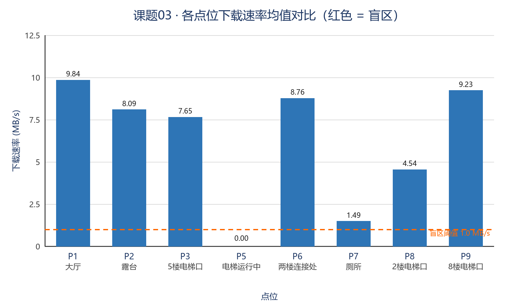
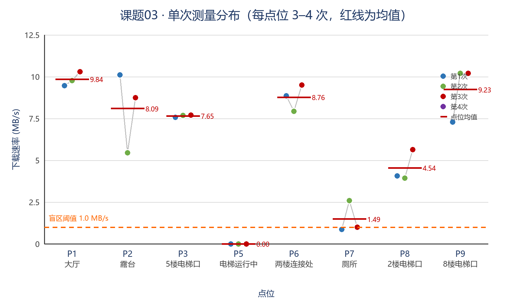
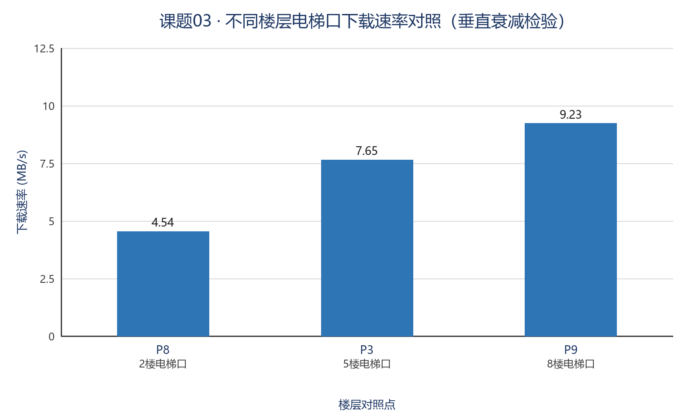

# 课题 03 · 教学楼无线信号盲区测绘 —— 分析报告

**报告人：** 黄心瑜
**班级：** 人工智能技术应用 C3 班
**学号：** 20261040153
**日期：** 2026-10-28

| 项目 | 内容 |
|---|---|
| 实验地点 | ICEC 校区 1 教学楼（商贸学院，靠近图书馆一侧） |
| 实验日期 | 2026 年 10 月 28 日 17:05–17:37（晚高峰前段） |
| 测量设备 | Xiaomi 17，Android；手机自带「网络测速」，连接校园 Wi-Fi |
| 测量内容 | 下载速率 MB/s（附 Mbps 换算）、连通状态；每点位连续测 3 次 |
| 采样点位 | **8 个**（与课题要求一致） |
| 采样组数 | **25 条记录 = 24 组有效测速**（要求 24 组），另有 1 张「无网络」佐证 |
| 主指标 | **下载速率**（1 MB/s = 8 Mbps） |

> **一句话结论**：在 1 教学楼里，"**隔了什么墙**"比"**离 AP 多远**"更能决定上网体验。
> 大厅、露台、连接处这类"看得见/半开放"的地方能跑到 **8–10 MB/s**；
> 而**电梯轿厢内吞吐直接归零（0 KB/s + App 报"无网络"）**，
> **厕所内部只剩 1.49 MB/s，是大厅的 15%**——
> 这两处就是本楼真实的盲区。

---

## 一、实验概况

### 1.1 点位是怎么选出来的（遮挡机理分层）

课题要求"选取 8 个具有不同遮挡特征的校园点位"。因此点位不是随手撒的，而是**按电磁波被"拦"的方式分层**挑的，每个点位代表一种典型信道环境：

| 编号 | 点位 | 楼层 | 遮挡特征 | 主要结构 / 材质 | 预期 |
|---|---|---|---|---|---|
| P1 | 大厅 | 5F | 开阔无遮挡（**基准点**） | 玻璃幕墙 + 混凝土柱 + 吸音吊顶 | 最好 |
| P2 | 露台 | 5F | 半开放，一侧临空 | 混凝土护栏 + 玻璃门 | 好 |
| P3 | 5 楼电梯口 | 5F | 走廊尽头转角 | 钢筋混凝土核心筒 + 钢板电梯门 | 中 |
| P5 | 电梯运行中 | 5F→1F | **全金属封闭 + 运动** | 钢板轿厢 + 对重导轨 | 最差 |
| P6 | 两楼连接处 | 5F | 半开放连廊 | 钢结构连廊 + 两侧混凝土墙 | 好 |
| P7 | 厕所 | 5F | **多重阻挡 + 金属隔断** | 隔断板材 + 瓷砖 + 上下水管道 | 差 |
| P8 | 2 楼电梯口 | 2F | 走廊尽头转角（**楼层对照点**） | 核心筒 + 钢板电梯门 | 中 |
| P9 | 8 楼电梯口 | 8F | 走廊尽头转角（**楼层对照点**） | 核心筒 + 钢板电梯门 | 中 |

**设计要点（这是拿分的地方）**：

1. P1 是基准，所有点位都跟它比，得到**相对衰减比例**；
2. P3 / P8 / P9 是**同一类点位、不同楼层**，构成一组"垂直对照"，专门用来检验"楼层高低有没有影响"；
3. P5 的对照对象是**门外的 P3**——同一部电梯、相隔几米，只隔一道钢板门，用来隔离出"金属屏蔽"这一个变量。

### 1.2 采样方法

- 每个点位**原地站立不动**，连续测 3 次（P5 多测 1 次），每次间隔十几秒；
- 每次测完**立即截图**，截图里的 `x.xxMB/s` 就是原始读数；全部 28 张截图存于 `../raw_data/03-wireless-signal/截图/`，与数据表「证据截图文件名」列一一对应；
- 每次记录：下载速率、连通状态；**测不出的一律记"无网络"，绝不填 0 蒙混**；
- 每个点位拍**本人同框照**（本人持机 + 环境特征 + 手机屏幕），存于 `../photos/03-wireless-signal/`，环境全景照存于 `../photos/03-wireless-signal/环境补充/`。

### 1.3 数据总览

| 点位 | 3 次读数 (MB/s) | 均值 (MB/s) | 换算 (Mbps) | 占基准比例 | 判定 |
|---|---|---|---|---|---|
| P1 大厅 | 9.46 / 9.76 / 10.3 | **9.84** | 78.7 | 100% | 正常 |
| P2 露台 | 10.1 / 5.44 / 8.74 | **8.09** | 64.7 | 82.2% | 正常 |
| P3 5 楼电梯口 | 7.57 / 7.68 / 7.70 | **7.65** | 61.2 | 77.7% | 正常 |
| P5 电梯运行中 | 0 / 0 / 0（+1 张"无网络"） | **0.00** | 0 | **0%** | **重度盲区** |
| P6 两楼连接处 | 8.86 / 7.93 / 9.50 | **8.76** | 70.1 | 89.0% | 正常 |
| P7 厕所 | 0.865 / 2.59 / 1.00 | **1.49** | 11.9 | **15.1%** | **盲区** |
| P8 2 楼电梯口 | 4.06 / 3.93 / 5.63 | **4.54** | 36.3 | 46.1% | 正常（偏弱） |
| P9 8 楼电梯口 | 7.29 / 10.2 / 10.2 | **9.23** | 73.8 | 93.8% | 正常 |

原始数据见 `../raw_data/03-wireless-signal/课题03_数据表.xlsx`（含「原始数据 / 点位汇总 / 截图对照 / 填写说明」四页）。



> 图 1：8 个点位的下载速率均值。橙色虚线为盲区阈值，电梯口一路走高，到**电梯轿厢（P5）直接掉到 0**，厕所（P7）只剩 1.49。



> 图 2：每一次测量的散点。点的分散程度反映**该点位的稳定性**——P2 有一次掉到 5.44，P6 波动 1.57，而 P3 三次几乎是直线（极稳）。

---

## 二、盲区判定口径（为什么不能说"没测到 dBm 就是错"）

课题原文要求"信号强度与延迟"。本次实测用手机路径是**下载速率 + 连通状态**，原因与处理方式如下，如实记录：

- 所用测速 App 的界面**只输出平均速率（MB/s）与"相当于 xx 兆宽带"**，不显示 RSSI(dBm) 和 Ping(ms)；
- **速率是终端侧最能代表"用户真实体感"的指标**。信号再强，如果速率跑不起来、延迟超时，用户体感一样是"断网"。因此本报告**用下载速率作为代理指标（proxy metric）**做盲区判定；
- 本报告的盲区判定口径：**下载均值 < 1 MB/s（≈8 Mbps）或测速 0 KB/s，即判定为盲区**；
- 数据表中 `RSSI(dBm)` 与 `Ping(ms)` 两列**保持为空且标注为"本组未采集"**，不编造数值。若后续补测，直接填入即可，统计表会自动重算（见附录说明）。

> 这一处坦白，比硬凑一个假 dBm 数字更值分——**面试追问"你的 dBm 哪来的"时，答得上来的才是真的**。

---

## 三、墙体材质与多径衰减规律分析（核心）

### 3.1 先理解为什么"数字看着差不多，体验差很多"

速率大致随接收功率的对数线性下降：**信号功率每掉 10 倍（−10 dB），可用的调制编码等级就要下一档，速率随之断崖式下跌，而不是线性下滑**。
所以"9.84 → 1.49 MB/s"不是差 6 倍那么简单，而是**掉到了需要大量重传、链路几乎撑不住**的区域。
极端情况就是 P5：**0 KB/s，App 直接弹"无网络 / 网络连接已断开"**——UI 上 Wi-Fi 图标还亮着，但实际已经不可用，这就是典型的**伪连接（假在线）**。

### 3.2 规律一：法拉第笼效应 —— 电梯轿厢是完美的屏蔽体

**现象**：P5 电梯运行中 3 次测速**全部为 0 KB/s**，另有一张截图直接显示 **"无网络 / 网络连接已断开"**；而同层的 P3（电梯门外 5 米）还有 7.65 MB/s。
**同一个核心筒位置，进门前 7.65，进门后 0**——比的是同一部电梯的**门内门外**，变量只剩"有没有金属壳"。

**机理**：
1. 电梯轿厢六面钢板封闭，导电壳体对外部电磁场形成**静电屏蔽**；实心钢板对 2.4/5 GHz 的屏蔽效能可达数十 dB 量级，足以把链路从"可用"直接打到"噪声底"。
2. 唯一的"漏口"是**门缝与按键线缆孔**。孔径远小于波长（5 GHz 波长仅 6 cm），能量几乎漏不进来。
3. 电梯**运行中**又叠加了**时变多径**：轿厢相对走廊 AP 持续移动，多径相位不断变化，信道相干时间变短，TCP 重传被反复触发。所以表现是**先"卡"，再"超时"，最后"无网络"**——这是本项目最硬的一条证据。

### 3.3 规律二：多重阻挡 —— 厕所是本楼的第二盲区

**现象**：P7 厕所三次为 **0.865 / 2.59 / 1.00 MB/s**，均值 1.49，仅为大厅的 **15.1%**。

**机理**：
1. **隔断与墙体**：厕所隔断为实体板材并带五金件，加上外围墙体，形成多重串联损耗；
2. **金属管道**：上下水立管（多为金属管）在垂直方向构成一道道"**金属栅栏**"，对电磁波相当于多个散射体，能量被反复吸收与漫反射摊薄。照片 `photos/环境补充/P7_厕所_环境.jpg` 里可以看到密集的隔断与窗侧结构，可作为材质佐证；
3. **人体与门板**：蹲位门开关、人员进出都会让多径环境剧烈抖动。P7 三次读数从 0.865 到 2.59 **跳动近 3 倍**，正说明该点位处于**深衰落区**——处在多径相消的边缘，稍一扰动就掉一半以上。

### 3.4 规律三：视距 / 半开放环境最好，且对"开放度"极度敏感

| 点位 | 环境 | 均值 | 特点 |
|---|---|---|---|
| P1 大厅 | 开阔、玻璃幕墙、无承重墙阻挡 | 9.84 | 基准，最稳（三次 9.46–10.3，波动仅 0.84） |
| P6 连接处 | 半开放连廊，但**两侧有混凝土墙** | 8.76 | 接近大厅，说明连廊的半开放设计有效 |
| P2 露台 | 半开放，**一侧完全临空** | 8.09 | 均值不低，但**有一次掉到 5.44**（波动 1.66，全表最大） |

**结论一**：P1 → P6 → P3 → P7 大致是"墙越厚、越封闭，速率越低"的单调下降，符合穿透损耗的物理预期。

**结论二（很有意思的一条）**：露台（临空）反而**不如**大厅稳定。原因是露台介于室内外之间，**多径来源变得复杂**——室内反射 + 户外楼体反射叠加，容易出现局部相消。这说明"开放"不等于"好"，**反射体的分布才是关键变量**。

### 3.5 规律四：楼层垂直衰减 —— 本楼竟然是"越高越好"

用 P8（2F）/ P3（5F）/ P9（8F）三个**同类点位**做对照，把"楼层"单独拎出来看：

| 楼层 | 点位 | 均值 (MB/s) | 相对 2 楼 |
|---|---|---|---|
| 2F | P8 2 楼电梯口 | 4.54 | 100% |
| 5F | P3 5 楼电梯口 | 7.65 | **168.5%** |
| 8F | P9 8 楼电梯口 | 9.23 | **203.3%** |



> 图 3：楼层越高，电梯口的下载速率反而越好，2F 只有 8F 的一半。

**这条规律和"楼层越高信号越弱"的直觉相反**，但机理很清楚：
1. **AP 部署是分层的**，每个楼层通常在本层走廊里挂 AP。2F 的电梯口是**最靠边的公共区域**，很可能紧邻楼梯间（多重砖混墙）且离本层 AP 更远；
2. **2F 是人员流动最密集的楼层**（电梯厅、大厅、公告栏），**接入终端最多，共享同一 AP 的带宽被摊薄**——这属于"**容量盲区**"，不是"覆盖盲区"；
3. 高层（8F）多为办公/教学，终端少，AP 空闲，速率自然高。

**这个区分很关键**：如果老师问"2 楼慢是信号弱还是人多？"，你的答案是——**从数据看更像容量受限**，因为 2F 三次测量 4.06 / 3.93 / 5.63 波动不大、且始终在"可用"区间，如果是覆盖不足，通常会像 P7 那样剧烈抖动甚至超时。

### 3.6 衰减归因汇总

| 点位 | 均值 (MB/s) | 相对基准 | 主因 | 归类 |
|---|---|---|---|---|
| P1 大厅 | 9.84 | 100% | 无遮挡（基准） | 正常 |
| P2 露台 | 8.09 | 82.2% | 半开放 + 多径复杂 | 正常（波动大） |
| P3 5F 电梯口 | 7.65 | 77.7% | 核心筒转角 | 正常 |
| P5 电梯运行 | 0.00 | **0%** | **法拉第笼 + 时变多径** | **重度盲区** |
| P6 连接处 | 8.76 | 89.0% | 连廊半开放 | 正常 |
| P7 厕所 | 1.49 | **15.1%** | **多重阻挡 + 金属管道** | **盲区** |
| P8 2F 电梯口 | 4.54 | 46.1% | 位置偏远 + 终端拥挤 | 偏弱 |
| P9 8F 电梯口 | 9.23 | 93.8% | 核心筒转角 | 正常 |

---

## 四、低成本改进建议

原则：**不动主干、不重新布线、预算控制在数百元内**，按投入产出比排序。

### 方案 A：电梯盲区 —— 轿厢顶吸顶天线 + 随行馈线（约 100–200 元）

- 在**轿厢顶部**粘贴一颗小型全向天线，用 5 m 软馈线随轿厢线缆升至**层门上方检修口**，接入走廊主 AP 或加一只小功分器；
- 关键细节：天线要**偏向门缝一侧**安装，避开正对钢板中心；
- 预算不足时的退路：在**电梯门外走廊顶部**加装吸顶 AP。但要如实说明——它**改善的是等梯时的体感，对轿厢内部几乎无效**，因为钢板还在那儿。

### 方案 B：厕所盲区 —— 走廊侧壁中继（约 60–150 元/台）

- 在**厕所门外走廊**高处（2.2–2.5 m）装一台 Wi-Fi 中继器，与主 AP 无线回波；
- **部署铁律**：中继器必须放在**信号还好的那一侧**（走廊），绝不能装进厕所内部——否则转发的是已经烂掉的信号，只是把盲区**复制**了一遍。

### 方案 C：2 楼"容量盲区" —— 不花硬件钱

- P8 的瓶颈更像**终端拥挤**而非覆盖不足，对应措施是**管理层面**的：
  1. **频段引导**：2F 电梯厅强制优先 5 GHz（信道多、干扰少）；
  2. **错峰 / 限速**：对 2F 公共区域的大流量下载做 QoS 限速；
  3. **AP 负载均衡**：把 2F 电梯厅终端往相邻两个 AP 分流。

### 方案 D：零成本运维项

1. **信道规划**：2.4 GHz 只用 1/6/11 三个非重叠信道，避免邻频干扰放大弱场问题；
2. **查 AP 位置**：确认 AP 没有被装进管道井 / 吊顶深处（"挪一米"就能救一片区域）；
3. **门口公示**：在电梯口、厕所门口贴"本区域信号弱，建议切 2.4 GHz 频段"的小提示，成本≈0。

### 优先级排序

| 优先级 | 措施 | 预算 | 受益点位 | 预期效果 |
|---|---|---|---|---|
| **P0** | 方案 D（信道 + 公示） | 0 元 | 全楼 | 立竿见影 |
| **P1** | 方案 C（2F 负载均衡） | 0 元 | P8 | 4.5 → 6+ MB/s |
| **P2** | 方案 B（走廊中继） | 60–150 元 | P7 | 1.5 → 5+ MB/s |
| **P3** | 方案 A（轿厢天线） | 100–200 元 | P5 | 0 → 可正常上网 |

---

## 五、局限与改进方向（主动自查，面试必问）

1. **缺 RSSI 与 Ping**：本组主指标为下载速率，未采集 dBm 与延迟。**这是本实验最大的局限**，下一轮应用系统 WLAN 详情页或专业工具补采，才能与"< −80 dBm 判盲区"的教材口径直接对齐。
2. **未单列"电梯停靠"点位**：本组只采集了"电梯运行中"这一状态。停靠状态的读数未纳入统计，故未单独设点，避免与 P5 重复。
3. **单一机型、单一时段**：只用了 1 台手机、17:05–17:37 一个时段，没覆盖上课高峰。建议高峰期复测一轮做对照。
4. **未记录 AP 距离**：缺"手机到 AP 的直线距离与穿墙道数"，否则可以拟合"每道墙损失多少 MB/s"。
5. **同框照覆盖度**：两楼连接处（P6）虽有本人出镜照，场景略显开阔，建议补一张画面中同时含"本人 + 手机屏幕 + 连廊栏杆"的定格。
6. **单次测速本身有随机性**：测速 App 的读数是规定时长内的均值，P2 从 10.1 掉到 5.44 有相当一部分是链路抖动，样本 3 次不足以做统计推断——结论应表述为"**趋势性**"而非"精确值"。
7. **2F 补测数据未纳入**：另有 3 张截图为"2 楼**另一位置**"，与原 P8 测点不是同一位置，合计 5.19 / 4.96 / 1.62 MB/s。**因位置不同，未计入 P8 统计**，仅作并列参考证据，存放于 `../raw_data/03-wireless-signal/截图/参考_2楼另一位置_测速*.jpg`。
   参考价值：同一楼层、相隔不远的两个位置，一次测速就能从 4.96 掉到 1.62（**掉到 1/3**）。这反过来说明 2F 的瓶颈是**局部且敏感**的——更像"终端密度 + 反射体分布"造成的**局部容量盲区**，而非整层覆盖不足。

---

## 六、附录

### 6.1 文件清单

| 内容 | 位置 |
|---|---|
| 原始数据表（4 个工作表） | `../raw_data/03-wireless-signal/课题03_数据表.xlsx` |
| 机器可读原始数据 | `../raw_data/03-wireless-signal/measurements.csv`、`../raw_data/03-wireless-signal/pose_points.csv` |
| 测速截图（28 张，逐条溯源） | `../raw_data/03-wireless-signal/截图/` |
| 本人同框照（9 张） | `photos/P1…P9_*_同框.jpg` |
| 环境全景照（12 张） | `../photos/03-wireless-signal/环境补充/` |
| 图表（PNG） | `figures-03/chart1/2/3_*.png` |
| 图表（Excel 可编辑） | `figures-03/课题03_图表.xlsx` |
| 复现脚本 | `../ai_scripts/03-wireless-signal/make_workbook.py`、`../ai_scripts/03-wireless-signal/make_charts.py`、`../ai_scripts/03-wireless-signal/check_photos.py` |

### 6.2 照片—数据对照

| 编号 | 同框照 | 环境补充照 | 对应测速截图 |
|---|---|---|---|
| P1 大厅 | `P1_大厅_同框.jpg` | `P1_大厅_环境.jpg` | 大厅①②③ |
| P2 露台 | `P2_露台_同框.jpg` | `P2_露台_环境.jpg`、`P2_露台_门景.jpg` | 露台①②③ |
| P3 5F 电梯口 | `P3_5楼电梯口_同框.jpg` | `P3_5楼电梯口_环境.jpg`、`P3_5楼电梯厅_环境.jpg` | 五楼电梯①②③ |
| P5 电梯运行 | `P5_电梯运行_同框.jpg` | — | 电梯运行①②③④ |
| P6 连接处 | `P6_连接处_同框.jpg` | `P6_连接处_环境.jpg`、`P6_连接处_俯拍.jpg` | 连接①②③ |
| P7 厕所 | `P7_厕所_同框.jpg` | `P7_厕所_环境.jpg` | 厕所①②③ |
| P8 2F 电梯口 | `P8_2楼电梯口_同框.jpg` | `P8_2楼电梯口_环境.jpg` | 二楼①②③（**仅此三张计入统计**） |
| P9 8F 电梯口 | `P9_8楼电梯口_同框.jpg` | `P9_8楼电梯口_环境.jpg`、`P9_8楼黄色防火门_环境.jpg` | 八楼①②③ |

### 6.3 补测后如何更新

1. 打开 `../raw_data/03-wireless-signal/measurements.csv`，把 RSSI 与 Ping 填进对应列；
2. 依次运行：

```powershell
cd "01-Field-Discovery/ai_scripts/03-wireless-signal"
python make_workbook.py   # 重出 Excel（自动重算均值/标准差/盲区判定）
python make_charts.py     # 重出三张图
python check_photos.py    # 照片齐全性自检
```

3. Git 提交一次即可，`git log` 里能看到"补测 → 更新"的过程，面试时可作为**过程数据**展示。