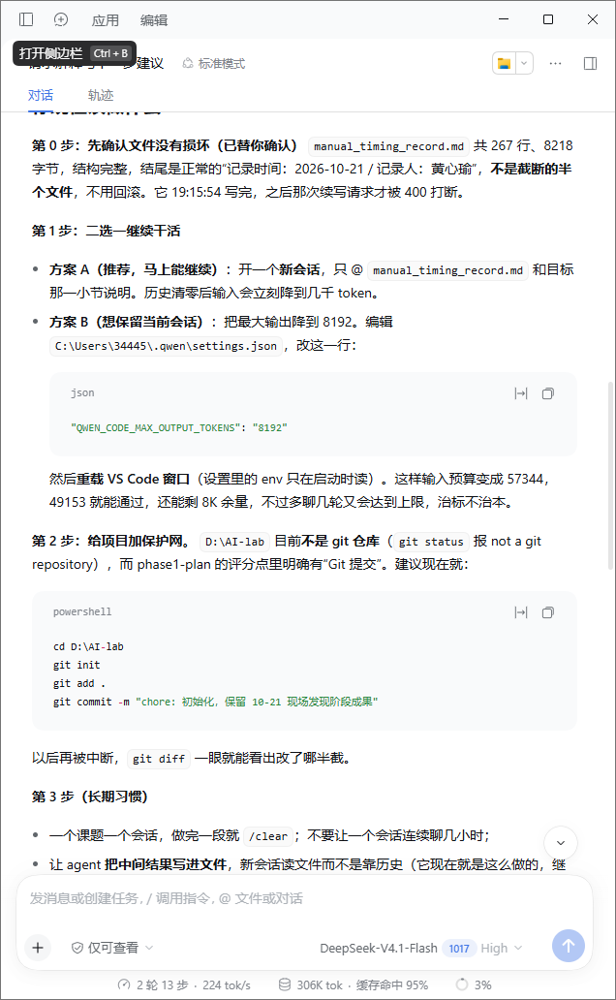
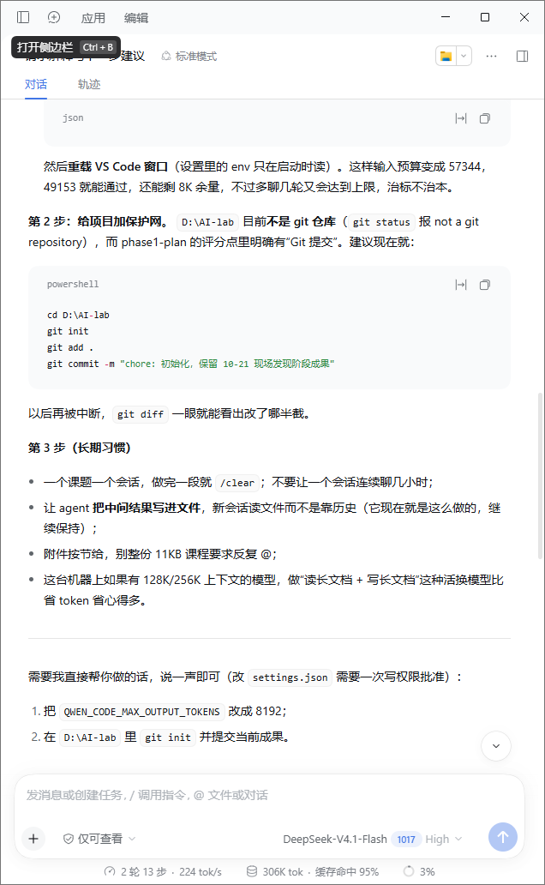
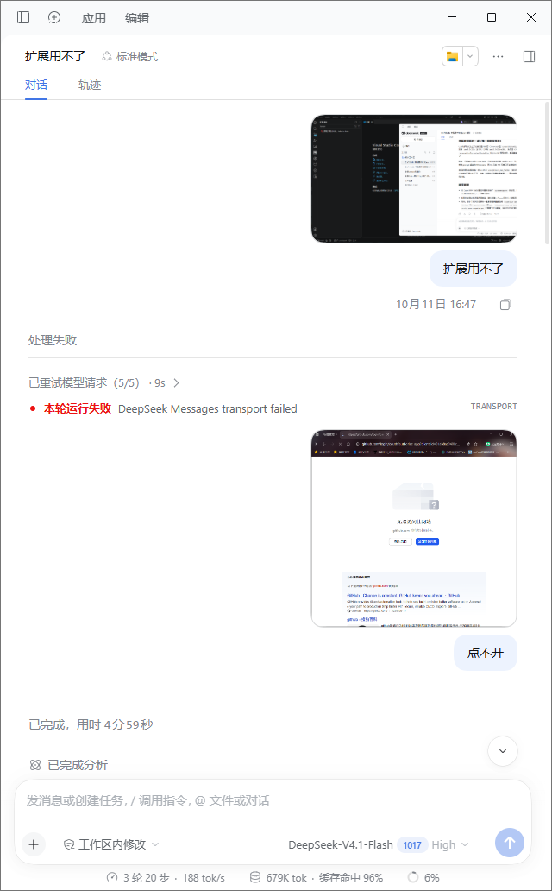
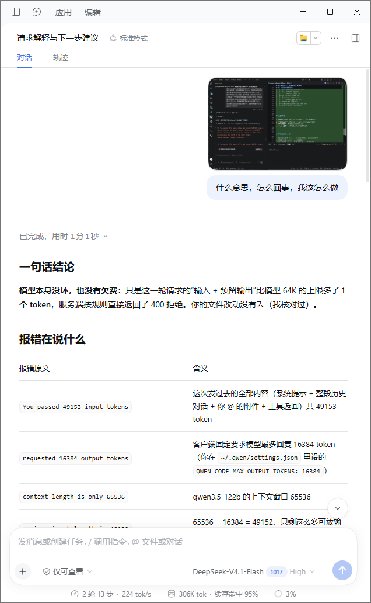

# AI 排障记录 01：请求被 400 拒绝 —— 输入 + 预留输出超过模型上下文上限

- **日期**：2026-10-21（更早的关联报错可追溯至 10-11 的「扩展用不了」会话）
- **环境**：VS Code + Qwen Code 扩展，界面显示模型 DeepSeek-V4.1-Flash（后端 qwen3.5-122b，上下文窗口 65536）
- **关键配置**：`C:\Users\34445\.qwen\settings.json` 中 `QWEN_CODE_MAX_OUTPUT_TOKENS = 16384`

## 现象
1. 10-11：「扩展用不了」——DeepSeek Messages transport failed，已重试模型请求 5/5 仍失败；页面「点不开」。
2. 10-21：向 `manual_timing_record.md`（267 行 / 8218 字节，19:54 正常写完，非截断文件）续写时，请求被服务端直接 400 拒绝。

### 证据截图
- 
- 
- 
- 

## 报错原文与含义
| 报错原文 | 含义 |
|---|---|
| `You passed 49153 input tokens` | 本轮发出的全部内容（系统提示 + 整段历史对话 + @ 附件 + 工具返回）共 49153 token |
| `requested 16384 output tokens` | 客户端固定预留 16384 token 给模型回复 |
| `context length is only 65536` | 模型上下文窗口只有 65536 |
| `65536 - 16384 = 49152` | 输入预算只剩 49152，实际输入 49153，超出 1 个 token → 400 |

## 根因
模型没坏、没有欠费、文件没损坏。纯粹是「输入 + 预留输出」比 64K 上限多了 1 个 token，服务端按规则拒绝。长文档反复 @ + 多轮历史把输入顶到了边界。

## 处置方案
- **方案 A（推荐）**：开新会话，只 @ `manual_timing_record.md` 和目标那一小节。历史清零后输入立刻降到几千 token。`QWEN_CODE_MAX_OUTPUT_TOKENS` 保持 16384 不动，不需要改。
- **方案 B（想保留当前会话）**：把 `QWEN_CODE_MAX_OUTPUT_TOKENS` 降到 8192 并重载 VS Code 窗口（env 只在启动时读）。预算变为 57344，49153 能通过，但多聊几轮还会撞墙，治标不治本。
- **加保护网**：`D:\AI-lab` 目前不是 git 仓库（`git status` 报 not a git repository），而 phase1-plan 评分点要求「每天提交」。建议立即：
  ```powershell
  cd D:\AI-lab
  git init
  git add .
  git commit -m "chore: 初始化，保留 10-21 现场发现阶段成果"
  ```
  以后再被中断，`git diff` 一眼能看出改到了哪半截。

## 长期习惯（防复发）
- 一个课题一个会话，做完一段就 `/clear` 或开新会话，别让一条会话连聊几小时。
- 让文件当记忆：每轮结束前让 agent 把结论写回 md，下一轮只 @ 文件；想回到旧话题也是「新会话 + @ 文件」。
- 附件按节给，别把整份 11KB 课程要求反复 @。
- 长文档 + 写长文档类任务，换 128K/256K 上下文的模型比省 token 管用。

## 结果验证
（待补：新会话续写是否成功、git init 是否已执行）
